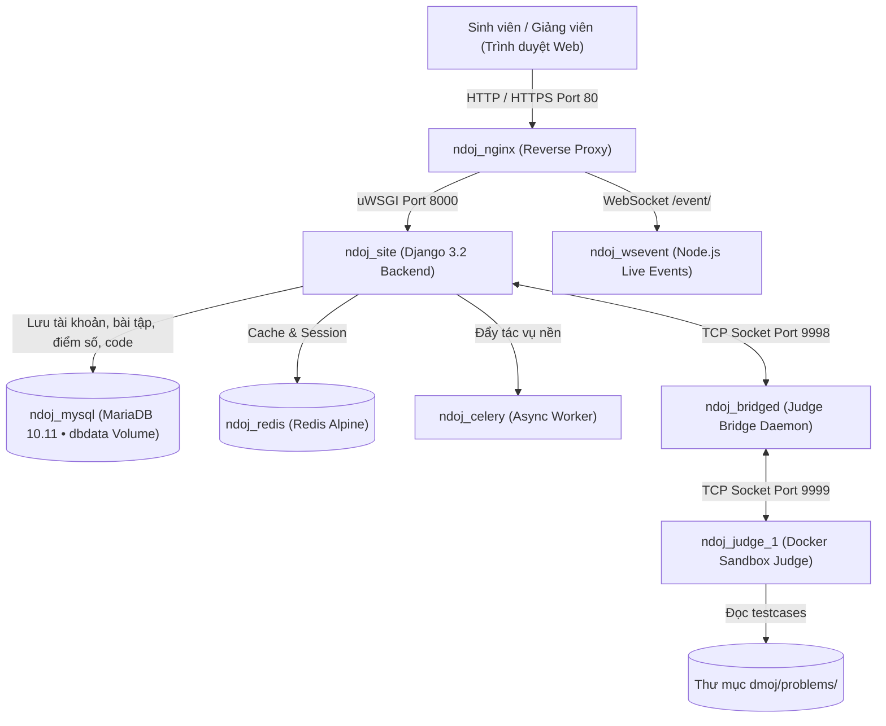

# UniPrep OJ - Trang Luyện Code Cho Sinh Viên
### Nền Tảng Chấm Bài & Rèn Luyện Lập Trình Trực Tuyến Tự Động Dành Cho Sinh Viên

<p align="center">
  
</p>

<p align="center">
  <b>Môi trường thực hành, trau dồi kỹ năng thuật toán, cấu trúc dữ liệu và giải quyết bài toán thực tế dành cho sinh viên CNTT các trường Đại học & Cao đẳng</b><br/>
  <i>Phát triển và tùy biến dựa trên nền tảng mã nguồn mở <b>VNOJ (Vietnam Online Judge) / DMOJ</b></i>
</p>

<p align="center">
  
  
  
  
  
  
</p>

---

## 🌟 1. Giới thiệu Nền tảng

**UniPrep OJ (UniPrep Online Judge)** là hệ thống kiểm tra và chấm bài lập trình trực tuyến tự động được thiết kế chuyên biệt phục vụ sinh viên trong suốt lộ trình học tập đại học: từ các môn cơ sở ngành (*Nhập môn lập trình, Kỹ thuật lập trình*), môn cốt lõi (*Cấu trúc dữ liệu & Giải thuật, Lập trình hướng đối tượng - OOP*), cho đến các sân chơi đỉnh cao như **Olympic Tin học Sinh viên Việt Nam**, kỳ thi quốc tế **ICPC** và chuẩn bị phỏng vấn kỹ thuật Coding Interview tại các tập đoàn công nghệ.

### 🚀 Tính năng Nổi bật
* **Chấm bài tự động thời gian thực (Real-time WebSocket Judging):** Tích hợp WebSocket daemon (`wsevent`), sinh viên quan sát kết quả chấm từng testcase (AC, WA, TLE, MLE, RTE) tức thì mà không cần tải lại trang.
* **Hỗ trợ đa ngôn ngữ lập trình chuẩn đại học:**
  * **C / C++ (C++17, C++20):** Tối ưu hóa hiệu năng, thư viện STL hoàn chỉnh.
  * **Python 3:** Thân thiện, hỗ trợ xử lý dữ liệu và thuật toán số học.
  * **Java:** Lập trình hướng đối tượng (OOP).
  * **Free Pascal (FPC):** Hỗ trợ chuyển tiếp kiến thức cơ bản.
* **Môi trường cách ly máy chấm an toàn (Sandbox Security):** Máy chấm (`judge-server`) vận hành trong môi trường cgroups & namespaces của Linux, kiểm soát nghiêm ngặt thời gian chạy (CPU Time) và bộ nhớ (RAM), ngăn chặn triệt để mã độc hoặc can thiệp hệ thống.
* **Tổ chức Kỳ thi (Contest) chuyên nghiệp:**
  * Hỗ trợ định dạng tính điểm **IOI** (tính điểm từng subtask) và **ACM-ICPC** (tính số bài AC và thời gian penalty).
  * Chế độ đóng băng bảng xếp hạng (Scoreboard freeze) tạo kịch tính cho kỳ thi.
  * Kỳ thi riêng tư (Private) bảo vệ bằng mật khẩu dành cho từng lớp học hoặc nhóm nghiên cứu.
* **Hệ thống Điểm số & Xếp hạng (Rating System):** Thuật toán tính Rating Elo/MMR chuẩn xác ghi nhận nỗ lực rèn luyện của sinh viên qua các kỳ thi tuần/tháng.
* **Ngân hàng bài tập phong phú:** Phân chia rõ ràng: Nhập môn lập trình (CS101), Cấu trúc dữ liệu & Giải thuật, Quy hoạch động & Đồ thị, Luyện thi Olympic & ICPC.
* **Giao diện thuần Việt & Hỗ trợ Dark Mode:** Tối ưu hóa trải nghiệm đọc code, hỗ trợ MathJax công thức toán học và giao diện Sáng / Tối hiện đại.

---

## 🏗️ 2. Kiến trúc Hệ thống (Architecture)

Hệ thống được đóng gói hoàn chỉnh bằng **Docker Compose** bao gồm 8 container dịch vụ phối hợp nhịp nhàng:



| Container | Image | Vai trò & Trách nhiệm |
| :--- | :--- | :--- |
| **`ndoj_nginx`** | `nginx:alpine` | Cổng web chính (Port 80/443), cân bằng tải, nén Gzip, cache Static/Media |
| **`ndoj_site`** | `ndoj/ndoj-site` | Backend Django + uWSGI xử lý toàn bộ logic web, tài khoản, đề bài, API |
| **`ndoj_judge_1`** | `dmoj/judge-small:latest` | Máy chấm Docker tự động biên dịch và thực thi code sinh viên trong sandbox an toàn |
| **`ndoj_bridged`** | `ndoj/ndoj-bridged` | Cầu nối socket bảo mật giao tiếp giữa trang web và các máy chấm |
| **`ndoj_celery`** | `ndoj/ndoj-celery` | Xử lý tác vụ nền bất đồng bộ (chấm lại hàng loạt bài nộp, cập nhật bảng xếp hạng) |
| **`ndoj_wsevent`** | `ndoj/ndoj-wsevent` | Node.js Daemon truyền tải tiến độ chấm thi trực tiếp tới trình duyệt qua WebSocket |
| **`ndoj_mysql`** | `mariadb:10.11` | Cơ sở dữ liệu lưu toàn bộ người dùng, bài tập, bài nộp (Docker Named Volume `dbdata`) |
| **`ndoj_redis`** | `redis:alpine` | Bộ nhớ tạm Redis và hàng đợi Message Broker cho Celery |

---

## ⚡ 3. Hướng dẫn Khởi chạy Nhanh

### Cách 1: Chạy trên Máy tính cá nhân (Windows PowerShell / Docker Desktop)

1. Cài đặt **Docker Desktop** (bật chế độ WSL2) và khởi động Docker.
2. Mở cửa sổ **PowerShell** tại thư mục dự án và thực hiện:

```powershell
# Di chuyển vào thư mục dmoj
cd dmoj

# Khởi chạy toàn bộ hệ thống
docker compose up -d
```

> [!TIP]
> **Khởi tạo lần đầu tiên:** Nếu bạn vừa clone mã nguồn về máy mới, chạy kịch bản tự động sau:
> ```powershell
> cd dmoj
> .\scripts\initialize.bat
> docker compose build base
> docker compose build
> docker compose up -d
> .\scripts\migrate.bat
> .\scripts\copy_static.bat
> .\scripts\seed_ndoj.bat
> ```

3. Mở trình duyệt truy cập: **[http://localhost/](http://localhost/)**.

---

### Cách 2: Triển khai 1-Chạm lên Máy chủ VPS Linux (Ubuntu / Debian)

Chuẩn bị một máy chủ Ubuntu (20.04 / 22.04 / 24.04 LTS), chạy đúng **1 lệnh duy nhất**:

```bash
sudo bash scripts/setup_vps.sh
```
Toàn bộ quá trình cài đặt Docker, cấu hình tường lửa, sinh mật khẩu ngẫu nhiên an toàn, khởi chạy các container và nạp dữ liệu mẫu sinh viên sẽ diễn ra tự động 100%!

* **Bật chứng chỉ bảo mật SSL HTTPS miễn phí cho tên miền (Let's Encrypt):**
```bash
sudo bash scripts/setup_ssl.sh your-domain.com
```

---

## 🔐 4. Tài khoản Quản trị Mặc định (Default Admin)

* **URL Đăng nhập:** [http://localhost/accounts/login/](http://localhost/accounts/login/)
* **Tên đăng nhập:** `admin`
* **Mật khẩu mặc định:** `NguyenDu@2026`
* **Email quản trị:** `admin@uniprepoj.com`

*(Bạn có thể đổi mật khẩu bất kỳ lúc nào sau khi đăng nhập tại trang thông tin cá nhân hoặc qua trang Quản trị Django `/admin/`)*.

---

## 💾 5. Quản lý & Sao lưu Dữ liệu (Backup & Restore)

### Dữ liệu được lưu ở đâu?
1. **Toàn bộ tài khoản, mật khẩu mã hóa, mã nguồn bài nộp, điểm số, kỳ thi:** Lưu vĩnh viễn trong Docker volume `dbdata` của MariaDB (không bị mất khi `docker compose down` hay khởi động lại máy).
2. **Bộ testcase bài tập (`.in`, `.out`):** Lưu trữ tại thư mục vật lý `dmoj/problems/`.
3. **Ảnh đại diện & tài liệu đính kèm:** Lưu trữ tại thư mục vật lý `dmoj/media/`.

### Lệnh Sao lưu (Backup 1-chạm):
```powershell
# Chạy trong thư mục dmoj
.\scripts\backup.bat
```
File sao lưu sẽ được xuất tự động sang thư mục `dmoj\backups\ndoj_db_<timestamp>.sql`.

### Lệnh Khôi phục (Restore 1-chạm):
```powershell
# Tự động khôi phục bản backup mới nhất:
.\scripts\restore.bat

# Hoặc khôi phục file cụ thể:
.\scripts\restore.bat backups\ndoj_db_20261019_203611.sql
```

---

## 🛠️ 6. Bảng Tra Cứu Lệnh Thường Dùng (Cheat Sheet)

Tất cả các lệnh thực hiện tại thư mục `dmoj/`:

| Tác vụ | Lệnh Windows (PowerShell / CMD) | Lệnh Linux / macOS (Bash) |
| :--- | :--- | :--- |
| **Bật hệ thống** | `docker compose up -d` | `docker compose up -d` |
| **Tắt hệ thống** | `docker compose down` | `docker compose down` |
| **Khởi động lại** | `docker compose restart` | `docker compose restart` |
| **Xem trạng thái container** | `docker compose ps` | `docker compose ps` |
| **Xem log máy chấm** | `docker compose logs judge -f` | `docker compose logs judge -f` |
| **Sao lưu Database** | `.\scripts\backup.bat` | `./scripts/backup` |
| **Khôi phục Database** | `.\scripts\restore.bat` | `./scripts/restore` |
| **Tạo thêm Super Admin** | `.\scripts\create_admin.bat <user> <pass> <mail>` | `./scripts/create_admin <user> <pass> <mail>` |
| **Chạy Django Shell** | `.\scripts\manage.bat shell` | `./scripts/manage shell` |
| **Cập nhật giao diện / static** | `.\scripts\copy_static.bat` | `./scripts/copy_static` |

---

## 📂 7. Cấu trúc Thư mục Dự án

```text
NDOJ/
├── dmoj/
│   ├── base/               # Dockerfile base (Python 3.11, C/C++, NodeJS, dependencies)
│   ├── site/               # Dockerfile & cấu hình cho Django Web
│   ├── celery/             # Dockerfile cho Celery Worker
│   ├── bridged/            # Dockerfile cho Judge Bridge Daemon
│   ├── wsevent/            # Dockerfile cho Node.js WebSocket Daemon
│   ├── nginx/              # Cấu hình Nginx Reverse Proxy
│   ├── config/             # Cấu hình local_settings.py, judge.yml, uwsgi.ini
│   ├── environment/        # File cấu hình biến môi trường (.env)
│   ├── fixtures/           # Dữ liệu mẫu khởi tạo (UniPrep OJ, navbar, ngôn ngữ)
│   ├── problems/           # Thư mục chứa đề bài & bộ testcases (.in, .out)
│   ├── sample_problems/    # Các bài tập mẫu khởi đầu (hello_uniprep, sum_ab, prime)
│   ├── media/              # Thư mục lưu trữ media và avatar upload
│   ├── backups/            # Thư mục lưu file sao lưu cơ sở dữ liệu (.sql)
│   ├── scripts/            # Bộ kịch bản tự động hóa vận hành (.bat, .ps1, shell)
│   └── docker-compose.yml  # File điều phối 8 container dịch vụ
├── scripts/
│   ├── setup_vps.sh        # Kịch bản cài đặt 1-chạm lên máy chủ VPS Linux
│   ├── setup_ssl.sh        # Cấu hình SSL HTTPS Let's Encrypt tự động
│   ├── update.sh           # Cập nhật mã nguồn hệ thống an toàn
│   └── add_external_judge.sh # Hướng dẫn nối thêm máy chấm phụ bên ngoài
├── DOCS/                   # Bộ tài liệu nghiệp vụ chi tiết
└── README.md               # Tài liệu hướng dẫn sử dụng chính
```

---

## 📚 8. Tài liệu Nghiệp vụ Bổ trợ

* 📖 **[Hướng dẫn Triển khai VPS & Vận hành](DOCS/HUONG_DAN_TRIEN_KHAI_VPS.md)**: Chi tiết mua VPS, trỏ DNS, cài đặt 1-chạm, backup và tối ưu RAM Swap.
* 👨‍🏫 **[Cẩm nang Quản trị dành cho Giảng viên](DOCS/HUONG_DAN_QUAN_TRI_GIAO_VIEN.md)**: Hướng dẫn tạo bài tập mới, soạn thảo Markdown, upload testcase zip, tổ chức kỳ thi, quản lý sinh viên và chấm lại bài.
* 👨‍🎓 **[Cẩm nang Hướng dẫn Sinh viên làm bài](DOCS/HUONG_DAN_HOC_SINH.md)**: Hướng dẫn đăng ký tài khoản, quy tắc nhập xuất (stdin/stdout), mẫu code C++, Python, Java và ý nghĩa các kết quả AC, WA, TLE, MLE, CE.

---

## 🤝 Đóng góp & Bản quyền

* Hệ thống **UniPrep OJ** được phát triển và tối ưu hóa dựa trên nền tảng nguồn mở của dự án [VNOJ (VNOI-Admin)](https://github.com/VNOI-Admin) và dự án [DMOJ](https://github.com/DMOJ).
* Trân trọng cảm ơn cộng đồng Tin học trẻ Việt Nam (VNOI) và các bạn sinh viên đã đồng hành cùng nền tảng!

---
© 2026 **UniPrep OJ - Trang luyện code cho sinh viên**.  
Motto: *"Rèn luyện tư duy thuật toán - Bứt phá sự nghiệp lập trình"*
